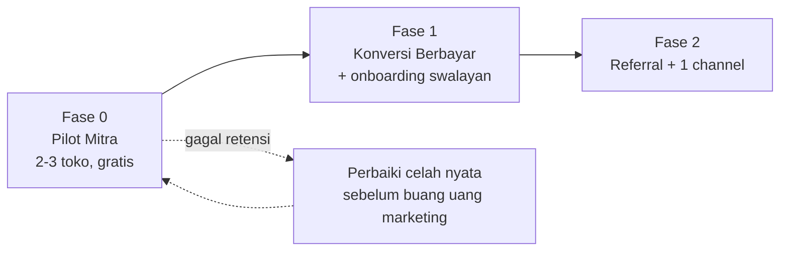

# Roadmap & Strategi Penjualan FixMaster

> Dokumen hidup. Perbarui tiap selesai satu fase atau saat ada temuan baru dari lapangan.
> Dibuat: 11 Jun 2026.

---

## Verdict: apakah FixMaster layak dijual?

Ada dua jenis "siap" yang sering ketuker:

| Aspek | Status | Catatan |
|---|---|---|
| **Siap fitur** (produk) | ✅ Matang | Loop inti lengkap (tiket→kasir→stok→keuangan→laporan), offline-first, RLS teruji, 288 test hijau, demo live, QRIS terintegrasi |
| **Siap bisnis** (pasar) | ❌ Belum tervalidasi | **Nol toko sungguhan** yang menjalankan usaha hariannya di atas FixMaster |

**Kesimpulan:** FixMaster **layak diuji-jual sekarang**, tapi **belum terbukti layak jual massal**. Yang memisahkan keduanya **bukan fitur tambahan** — melainkan bukti bahwa toko nyata mau memakainya terus-menerus dan mau membayar.

> [!IMPORTANT]
> Risiko terbesar bukan "produk kurang lengkap" (produk sudah lebih matang dari banyak yang berani jualan). Risikonya: **belum ada bukti orang non-teknis mau memakainya terus & membayar.** Itu hanya ditemukan di lapangan. Bahaya nyata untuk produk sematang ini adalah terus *menambah fitur* sebagai pelarian dari ketakutan menghadapi pasar.

### Kenapa posisimu kuat (aset yang langka dimiliki bersamaan)
- **Full-time** → bisa mendampingi pilot secara intens.
- **Kenal beberapa pemilik toko servis** → pintu masuk hangat (kebanyakan orang harus cari dari nol).
- **QRIS sudah jalan** (listener GoPay, bebas MDR) → hambatan pembayaran sudah hilang.

Kamu sudah siap menjalankan langkah validasi terpenting. Tidak perlu menunggu apa-apa lagi.

---

## Roadmap 3 fase

### Fase 0 — Pilot Mitra (FOKUS SATU-SATUNYA SEKARANG)
**Tujuan:** membuktikan toko nyata mau pakai & bertahan. Bukan cari uang dulu.

- Ambil **2–3 toko** dari kenalanmu.
- Tawarkan **gratis / "harga pendiri"** ditukar: feedback jujur + izin mengamati mereka memakainya.
- Dampingi onboarding langsung (datang ke toko / screen-share).
- **Catat tiap titik mereka bingung** — gesekan itu = roadmap aslimu.

> [!TIP]
> **Kriteria LULUS Fase 0:** minimal 1–2 toko **masih aktif memakai di minggu ke-3 TANPA kamu suruh**, dan mencatat transaksi nyata (bukan data coba-coba). Kalau mereka balik ke buku/WhatsApp → kamu menemukan celah nyata sebelum buang uang marketing. Itu kemenangan, bukan kegagalan.

### Fase 1 — Konversi Berbayar + Onboarding Swalayan
**Tujuan:** dapat pembayaran pertama dari orang yang **bukan teman**, dan bikin produk bisa dipakai tanpa pendampinganmu.

- Begitu pilot bilang "ini aku mau bayar" → mulai tagih (boleh diskon founding member).
- Pakai gesekan dari Fase 0 untuk bikin onboarding **swalayan** (in-app guide, data contoh, checklist setup).
- Selesaikan jalur **impor data lama** & **aktivasi otomatis setelah bayar** (lihat "Celah siap-bisnis").

> [!TIP]
> **Kriteria LULUS Fase 1:** ada pelanggan membayar yang **bukan kenalan dekat**, DAN minimal satu toko berhasil setup sendiri tanpa kamu dampingi langkah-demi-langkah.

### Fase 2 — Referral + Satu Channel Sempit
**Tujuan:** pertumbuhan yang bisa diulang.

- Pemilik toko percaya sesama pemilik toko → testimoni pilot + **referral** = mesin jual terkuat di niche ini.
- Pilih **SATU** channel yang terbukti dari pilot (grup FB/WA teknisi servis lokal, marketplace komunitas, dll). Jangan sebar ke mana-mana.
- SEO (sudah dikerjakan) jadi pelengkap jangka panjang, bukan tuas utama.

> [!TIP]
> **Kriteria LULUS Fase 2:** datang pelanggan baru dari referral/channel **tanpa kamu kejar satu-satu**.

---

## Skrip menawarkan pilot (ke kenalanmu)

Jangan "jualan". Minta tolong & tawarkan nilai. Nada santai:

> "Bang, aku lagi bikin aplikasi buat ngatur toko servis — tiket servis, kasir, stok, keuangan, jadi satu. Aku butuh 2–3 toko buat coba pakai beneran sebulan, **gratis**, sebagai mitra awal. Imbalannya cuma minta jujur: mana yang ngebantu, mana yang ribet. Kalau cocok, nanti dapat harga khusus pendiri selamanya. Abang mau jadi salah satunya? Aku yang pasangin & dampingin langsung."

Kenapa ini efektif:
- "Gratis + mitra awal" menghapus risiko buat mereka.
- "Minta jujur" mengundang feedback, bukan basa-basi.
- "Harga pendiri selamanya" menanam benih konversi berbayar.
- "Aku pasangin & dampingin" menghapus hambatan setup (penyebab #1 orang menyerah).

**Penting:** jangan beri ke >3 toko dulu. Kamu butuh kedalaman observasi, bukan jumlah.

---

## Scorecard Pilot — cara tahu FixMaster "lulus"

Ukur ini per toko, tiap minggu, selama 3–4 minggu:

| Metrik | Cara ukur | Sinyal SEHAT |
|---|---|---|
| **Aktivasi** | Berapa lama dari daftar → tiket/transaksi pertama | < 1 hari |
| **Retensi mingguan** | Apakah login & input data minggu ini? | Aktif 3 minggu berturut-turut |
| **Kedalaman pakai** | Modul apa yang dipakai rutin (servis, kasir, stok…) | ≥ 3 modul inti |
| **Inisiatif sendiri** | Pakai tanpa kamu ingatkan? | Ya |
| **Niat bayar** | "Kalau ini berbayar Rp99rb/bln, abang lanjut?" | "Ya" yang meyakinkan |
| **Friksi** | Daftar momen mereka bingung/menyerah | Menurun tiap minggu |

> [!CAUTION]
> Sinyal **bahaya** yang harus kamu hadapi jujur: mereka berhenti pakai setelah minggu pertama, atau balik ke buku/WhatsApp "karena lebih cepat". Kalau ini terjadi, **jangan tambah fitur** — gali KENAPA. Biasanya akarnya: setup ribet, input terlalu lama, atau tak bisa bawa data lama.

---

## Dua celah "siap bisnis" yang perlu diselesaikan (paling lambat Fase 1)

### 1. Impor data lama
Pemilik toko sudah punya catatan di buku/Excel. Kalau pindah ke FixMaster berarti mulai dari nol, itu hambatan terbesar pindah sistem. Pilot akan menunjukkan seberapa parah. Minimal sediakan jalur impor pelanggan & stok.

### 2. Aktivasi setelah bayar
QRIS via listener GoPay sudah jalan. Yang perlu diperjelas: setelah pelanggan bayar, akun aktif **otomatis** atau kamu **aktifkan manual**? Jawaban sekarang: otomatis **bila** pelanggan membayar nominal persis dan listener sedang hidup; kalau tidak, jatuh ke konfirmasi manual.
- Manual = oke untuk pilot (volume kecil).
- Jadi penghambat saat skala → otomasi sebelum Fase 2.

---

## Yang JANGAN dilakukan sekarang

- ❌ Menambah fitur baru (kecuali pilot membuktikan satu fitur jadi penghalang bayar).
- ❌ Peluncuran publik / iklan berbayar (prematur tanpa bukti retensi).
- ❌ Menunggu trafik SEO organik sebagai sumber pelanggan pertama (terlalu lambat; pilot jauh lebih cepat).
- ❌ Menyempurnakan landing page lagi (sudah cukup baik untuk Fase 0–1).

---

## Ringkasan satu kalimat

**Produkmu sudah matang; yang belum adalah bukti pasar. Ambil 2–3 toko kenalanmu minggu ini, dampingi, dan ukur apakah mereka bertahan 3 minggu — itu satu-satunya hal yang menentukan FixMaster layak dijual atau belum.**
